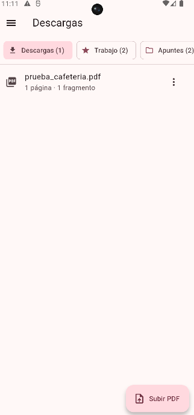
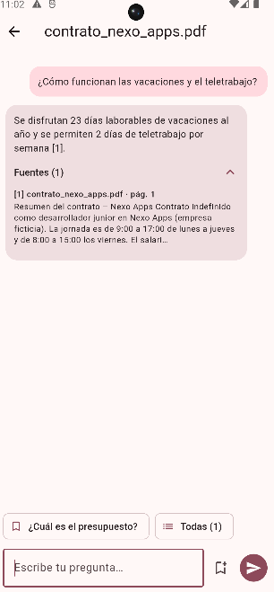
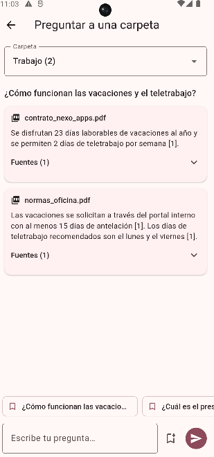
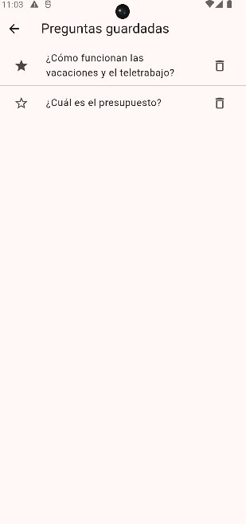
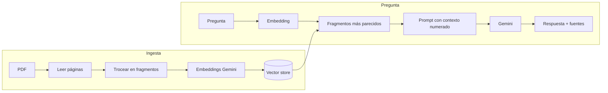

<p align="center">
  
</p>

<h1 align="center">DocuChat</h1>

<p align="center">
  Sube tus PDFs, ordénalos en carpetas y hazles preguntas.<br>
  Una IA responde <b>solo con lo que pone en tus documentos</b> y cita la página de donde lo saca.
</p>

<p align="center">
  Flutter · Spring Boot · Spring AI · Google Gemini · RAG
</p>

---

## Capturas

| Inicio | Chat con un PDF | Preguntar a una carpeta | Preguntas guardadas |
|:---:|:---:|:---:|:---:|
|  |  |  |  |

## Funcionalidades

- **Chat con cada PDF**: respuestas basadas solo en el documento, con las fuentes citadas (`[1]`, `[2]`…) y el fragmento original de cada una.
- **Respuestas en streaming**: el texto aparece mientras se genera.
- **Si la respuesta no está en el documento, lo dice**: no se inventa nada.
- **Carpetas**: Descargas por defecto, carpetas propias, favoritas primero; renombrar, mover documentos y eliminar.
- **Preguntar a una carpeta**: la misma pregunta a todos sus documentos, con una respuesta por documento.
- **Preguntas guardadas**: se reutilizan con un toque en cualquier documento; favoritas, búsqueda, edición y borrado.

## Cómo funciona (RAG)



1. **Ingesta:** el PDF se lee página a página, se limpia, se trocea en fragmentos de unos 800 tokens y cada fragmento se convierte en un *embedding* (un vector que representa su significado).
2. **Recuperación:** la pregunta también se convierte en vector y se buscan los fragmentos más parecidos, filtrando por el documento elegido.
3. **Generación:** los fragmentos se pasan a Gemini como contexto numerado, con instrucciones de no inventar y de citar las fuentes. La respuesta se envía a la app en streaming (NDJSON).

## Stack

| Parte | Tecnología |
|---|---|
| App | Flutter · Material 3 · Dio (HTTP y streaming) · file_picker |
| Backend | Java 21 · Spring Boot 3.5 · **Spring AI 1.1** |
| IA | Google Gemini: chat `gemini-3.5-flash-lite`, embeddings `gemini-embedding-001` |
| PDF | Lector de PDF de Spring AI (Apache PDFBox) |
| Persistencia | `SimpleVectorStore` y ficheros JSON (sin base de datos) |
| Documentación API | Swagger / OpenAPI |
| Tests | JUnit con una IA falsa (sin coste ni clave) · `flutter test` |

## API

| Método | Ruta | Descripción |
|---|---|---|
| `GET` | `/api/folders` | Carpetas (Descargas, favoritas y el resto) con su número de documentos |
| `POST` · `PATCH` · `DELETE` | `/api/folders` · `/api/folders/{id}` | Crear, renombrar o marcar favorita, y eliminar (los documentos pasan a Descargas) |
| `GET` | `/api/documents?folderId=` | Documentos de una carpeta, el más nuevo primero |
| `POST` | `/api/documents` | Subir un PDF (`multipart/form-data`: `file` y `folderId` opcional) |
| `PATCH` · `DELETE` | `/api/documents/{id}` | Mover a otra carpeta o eliminar |
| `POST` | `/api/chat/stream` | Pregunta a un documento; respuesta en streaming (NDJSON) |
| `POST` | `/api/chat/folder` | Pregunta a una carpeta; una línea NDJSON por documento |
| `GET` · `POST` · `PATCH` · `DELETE` | `/api/questions` | Preguntas guardadas |

Documentación interactiva: `http://localhost:8080/swagger-ui.html`

## Ejecutar en local

### Backend

Requisitos: **Java 21** y una clave gratuita de [Google AI Studio](https://aistudio.google.com/apikey).

```powershell
cd backend
$env:GEMINI_API_KEY="tu_clave"   # Linux/macOS: export GEMINI_API_KEY=tu_clave
.\mvnw spring-boot:run           # Linux/macOS: ./mvnw spring-boot:run
```

### App

Requisitos: **Flutter 3.35+** y un emulador de Android.

```powershell
cd app
flutter pub get
flutter run
```

La app se conecta a `http://10.0.2.2:8080`, que es el `localhost` del PC visto desde el emulador. Para un móvil físico:

```powershell
flutter run --dart-define=API_URL=http://IP_DE_TU_PC:8080
```

### Tests

```powershell
cd backend; .\mvnw test   # flujo completo con una IA falsa: no necesita clave
cd app; flutter test
```

## Decisiones de diseño

- **Una respuesta por documento al preguntar a una carpeta**, en lugar de mezclar fragmentos de todos: así se ve qué dice cada documento.
- **Modelo Flash-Lite con poco razonamiento** (`thinking-level: LOW`): en RAG la respuesta ya está en el contexto, así que se prioriza la velocidad.
- **Persistencia en JSON** para que el proyecto arranque sin instalar nada. El siguiente paso natural es PostgreSQL con pgvector.
- **Las claves nunca van en el código**: se leen de variables de entorno.

## Próximos pasos

- [ ] Docker y `docker-compose` con PostgreSQL + pgvector
- [ ] Usuarios y autenticación

## Autor

**Felipe López Escarpa** · [GitHub](https://github.com/kreatimes) · [Apps en Google Play](https://play.google.com/store/search?q=devlicius&c=apps)
