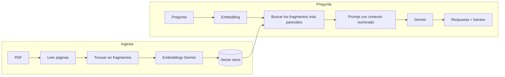

# DocuChat

Sube tus PDFs y hazles preguntas. Una IA responde **solo con lo que pone en tus documentos** y cita de qué página lo ha sacado.

Implementa **RAG** (*Retrieval-Augmented Generation*) con **Spring AI** y **Google Gemini**.

> 🚧 En desarrollo: el backend está terminado y la app en Flutter es la siguiente fase.

## Cómo funciona



1. **Ingesta:** el PDF se lee página a página, se trocea en fragmentos de unos 800 tokens y cada fragmento se convierte en un *embedding* (un vector que representa su significado).
2. **Recuperación:** la pregunta también se convierte en vector y se buscan los fragmentos más parecidos (similitud coseno). Se puede limitar la búsqueda a un documento.
3. **Generación:** los fragmentos se pasan a Gemini como contexto numerado, con instrucciones de no inventar y de citar las fuentes `[1]`, `[2]`…

## Stack

| Parte | Tecnología |
|---|---|
| Backend | Java 21 · Spring Boot 3.5 · **Spring AI 1.1** |
| IA | Google Gemini (chat `gemini-3.8-flash`, embeddings `gemini-embedding-001`) |
| PDF | Lector de PDF de Spring AI (Apache PDFBox) |
| Vectores | `SimpleVectorStore`, guardado en JSON (sin base de datos) |
| Docs API | Swagger / OpenAPI |
| App | Flutter *(en desarrollo)* |

## API

| Método | Ruta | Descripción |
|---|---|---|
| `POST` | `/api/documents` | Sube un PDF (`multipart/form-data`, campo `file`) |
| `GET` | `/api/documents` | Lista los documentos |
| `DELETE` | `/api/documents/{id}` | Borra un documento y sus vectores |
| `POST` | `/api/chat` | `{"question": "...", "documentId": "opcional"}` → respuesta + fuentes |

Ejemplo de respuesta:

```json
{
  "answer": "Los empleados tienen 23 días de vacaciones al año [1].",
  "sources": [
    { "number": 1, "filename": "convenio.pdf", "page": 4, "excerpt": "Los empleados tienen 23 días..." }
  ]
}
```

## Ejecutar en local

Requisitos: **Java 21** y una clave gratuita de [Google AI Studio](https://aistudio.google.com/apikey).

```powershell
cd backend
$env:GEMINI_API_KEY="tu_clave"   # Windows PowerShell  (Linux/macOS: export GEMINI_API_KEY=tu_clave)
.\mvnw spring-boot:run           # Linux/macOS: ./mvnw spring-boot:run
```

Abre `http://localhost:8080/swagger-ui.html`, sube un PDF en `POST /api/documents` y pregunta en `POST /api/chat`.

Tests (no necesitan clave, usan una IA falsa):

```powershell
.\mvnw test
```

## Próximos pasos

- [ ] App en Flutter: lista de documentos y chat
- [ ] Respuestas que van apareciendo mientras se generan (*streaming*)
- [ ] Cambiar `SimpleVectorStore` por PostgreSQL + pgvector

## Autor

**Felipe López Escarpa** · [GitHub](https://github.com/kreatimes) · [Apps en Google Play](https://play.google.com/store/search?q=devlicius&c=apps)
